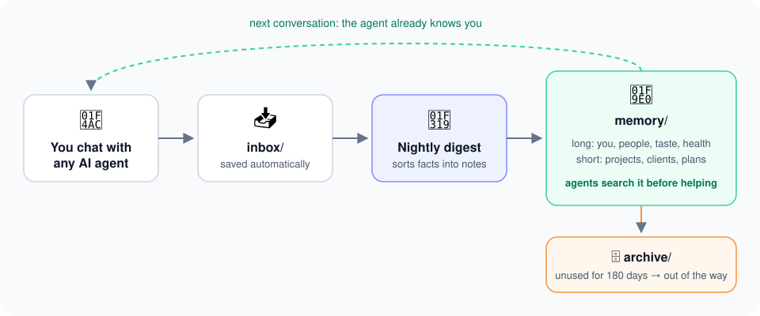

# j_brain

**A second brain for your AI agents, not for you.**

There are many second brain setups out there, and most of them feel overly complicated: plugins, tagging systems, daily notes you never keep up with. This is my simple version. It's a folder of plain markdown that your AI agents (Claude Code, Codex, Cursor) read before helping you, and that fills itself in from your conversations.



## What makes it different

- **Made for agents, not for you.** You never have to open, tag or tidy it. Agents search it when they need context ("who is Maya?", "recommend a film", "prep my meeting with Acme") and save new facts as you talk. You can browse it in Obsidian if you like, but you don't have to.
- **It forgets on purpose.** Projects, clients and plans that nobody has used for 180 days are moved to an archive automatically. The brain stays small and current instead of piling up stale, irrelevant notes.
- **It maintains itself.** Agents only drop things into `inbox/`. Once a night, one agent (the digest) sorts the inbox into tidy notes, rewrites outdated facts and logs what it changed.
- **Every fact has a source.** Each note links to the original conversation it came from, so agents can check facts and you can see where something came from.
- **Plain files, no lock-in.** Markdown in a git repo. Works with any agent that can read files.

## Set it up

Copy this prompt into Claude Code or Codex:

```text
Set up j_brain, a second brain for AI agents, for me. Steps:

1. Create my own PRIVATE GitHub repo from the template, and clone it to ~/j_brain:
   gh repo create j_brain --private --template jacobjelen/j_brain-template --clone
   (if `gh` isn't installed or logged in, help me fix that first). Move the clone to ~/j_brain if it isn't there.
2. Ask me my first name and full name. Then replace the fictional example person "John Doe" / "John"
   with my name in AGENTS.md, CLAUDE.md, INDEX.md, README.md and everything in system/.
3. Replace the example path "/Users/john/Library/CloudStorage/GoogleDrive-john@example.com/My Drive/j_brain"
   in AGENTS.md and system/skills/*/SKILL.md with the real absolute path of ~/j_brain.
4. Delete the example data: every .md file in memory/ (keep the folders and .gitkeep files), raw/2026/,
   inbox/*.md, log/*.md, and the rules (not the header) in system/rules/lessons.md.
5. Run: bash ~/j_brain/system/install.sh
   Then run python3 ~/j_brain/system/scripts/test_scripts.py and make sure it prints ok.
6. Commit and push.
7. Set up the nightly digest as a scheduled Claude Code routine on my new repo, using the prompt in
   system/routines/digest.md (replace the repo name and trigger ID in that file with the real ones).
8. Finally, use the brain-onboard skill to interview me for 5 minutes, so the brain isn't empty.
```

That's it. From then on, every agent knows the brain exists, checks it when a task needs context about you, and saves what it learns.

## How it works

| Folder | What's in it |
|---|---|
| `inbox/` | New facts and conversation transcripts, waiting for the digest. The only place agents write. |
| `memory/long/` | Things that stay true: you, your people, taste, health, skills. Never archived. |
| `memory/short/` | Things that come and go: projects, clients, plans. Archived after 180 days unused. |
| `raw/` | The original sources, after the digest has read them. Notes link here. |
| `log/` | What each nightly digest changed. |
| `archive/` | Stale short-term notes. Agents don't read it unless you ask. |
| `system/` | The rules, templates, skills, hooks and scripts that make it work. |

To add something by hand, tell any agent "remember that…", or drop a file into `inbox/`.

**Example data:** this template comes filled with notes about John Doe, a fictional person, so you can see what a working brain looks like. The setup prompt deletes them.

## Tests
```bash
python3 system/scripts/test_scripts.py   # the scripts
python3 system/scripts/lint.py           # the notes: frontmatter, links, sources
```
